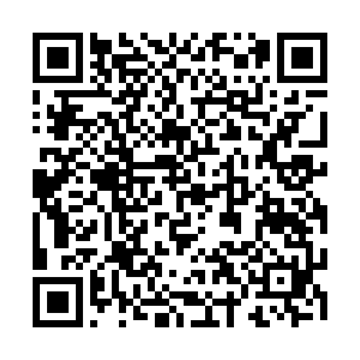

# Rattlegram Plus Plus

<p align="center">
  <a href="https://github.com/doodlecomms/Rattlegram_Plus-Plus/releases/latest/download/RattlegramPlusPlus.apk"></a>
</p>
<p align="center">
  <b>On your phone?</b> Tap the button above. <b>On a computer?</b> Scan this with your phone:<br>
  <a href="https://github.com/doodlecomms/Rattlegram_Plus-Plus/releases/latest/download/RattlegramPlusPlus.apk"></a>
</p>

Short text messages sent as sound — through the phone's speaker and microphone, a cable to a radio, or **wirelessly over Bluetooth to a BTech UV-Pro / Vero VR-N76**. No Wi-Fi or cellular network needed.

Rattlegram Plus Plus is an independent fork of [Rattlegram Plus](https://github.com/BI3BJU/Rattlegram_Plus) by BI3BJU, which itself builds on [Rattlegram](https://github.com/aicodix/rattlegram) by aicodix. It installs **alongside** Rattlegram Plus (it has its own app ID) and uses the same over-the-air format, so messages, pings and encrypted messages (with the same password) should work between the two apps.

| Main interface |
| :---: |
|  |

## What's new in Plus Plus

- 📻 **Bluetooth radio audio** — Menu → Bluetooth Radio connects to a paired **BTech UV-Pro** (and, by the same protocol, **Vero VR-N76**). Receive and transmit go over Bluetooth; the radio keys while it receives audio and is always unkeyed afterwards. No cable or DigiRig.
- 🔇 **Automatic radio speaker mute** — while connected, the radio's speaker is muted and its volume restored on disconnect (also after an unexpected drop).
- 🪖 **SALUTE report** — a form for Size, Activity, Location, Unit, Time, Equipment. Location from GPS as Lat/Long, Maidenhead or MGRS (or typed); time in UTC or local; a live byte counter so the report fits, including in encrypted messages.
- 🔑 **Password by QR code** — show the encryption password as a QR code, scan it on the other phone, or paste it. No more typing 64 random characters.
- ☑️ **Encrypt checkbox remembers** its last setting.
- 🗑️ **Delete Messages on Close** (optional, Danger Zone).
- 🧩 Fixed overlapping buttons in the password dialog.

## Everything from Rattlegram Plus

- 📡 Audio-based messaging (audible or ultrasonic)
- 🔐 Optional end-to-end encryption (AES-256-GCM, password based)
- 📍 Location sharing, opened in any map app
- 🔁 Repeater (relay) mode, 🕊️ loop beacon, 📶 spectrum analyzer
- 👤 Contacts, 🌙 night mode, persistent message history
- 🎚️ Sample rate, channel, audio source, carrier frequency and leading-noise settings

## Install

1. Download the latest APK: **[RattlegramPlusPlus.apk](https://github.com/doodlecomms/Rattlegram_Plus-Plus/releases/latest/download/RattlegramPlusPlus.apk)** (always the newest version; older ones are on the [Releases page](https://github.com/doodlecomms/Rattlegram_Plus-Plus/releases)).
2. Allow your browser or file manager to install unknown apps when Android asks.
3. Install and open it, then allow the microphone (needed to receive) and, if you want GPS features, location.

Requires Android 7.0 or newer.

> The early `v0.1-test` build used Rattlegram Plus's app ID. If you installed it, uninstall it before installing Plus Plus.

## Using a BTech UV-Pro over Bluetooth

1. **Pair the radio once:** put the UV-Pro in pairing mode (its light flashes red and green — see the radio's manual), then pair it in Android's Bluetooth settings. It shows up as `UV-PRO`. *(Menu → Bluetooth Radio → Connect / Disconnect → Pair new radio walks through this.)*
2. **Close other apps that use the radio**, such as HTCommander — the radio allows one connection at a time.
3. **Menu → Bluetooth Radio → Connect / Disconnect**, pick the radio, tap Connect. The status shows *Listening via UV-PRO*.
4. Send and receive as usual. While connected the microphone is off and the audio rate/channel settings are locked.

Tested with a UV-Pro (firmware 0.9.3) and Samsung Galaxy A15 phones. The Vero VR-N76 uses the same protocol but has not been tested yet — reports welcome.

## Sharing the encryption password

Danger Zone → Password: **Generate Random Password**, then **Show QR** on one phone and **Scan QR** (or Paste) on the other, and tap Okay on both. Anyone who sees the QR code can read your encrypted messages, so only show it to people you trust. The app does not save the password between launches.

## Building from source

```bash
git clone https://github.com/doodlecomms/Rattlegram_Plus-Plus.git
cd Rattlegram_Plus-Plus
./gradlew assembleDebug
```

Open it in Android Studio, or build from the command line as above (needs the Android SDK and NDK 28.2).

**Release builds** are signed with the key described in a `keystore.properties` file in the project root (it is git-ignored and never committed):

```properties
storeFile=/path/to/your-release-key.jks
storePassword=...
keyAlias=...
keyPassword=...
```

Without that file, `./gradlew assembleRelease` falls back to the debug key.

## Permissions

| Permission | Why |
| --- | --- |
| Microphone | Receive messages through the microphone |
| Location | GPS for location messages and SALUTE reports |
| Bluetooth (nearby devices) | Connect to a BTech UV-Pro / Vero VR-N76 |
| Camera | Scan a password QR code (asked only when you tap Scan QR) |
| Internet | Map display for received locations |

## Credits and license

- **Rattlegram** — Copyright 2022 aicodix GmbH, BSD Zero Clause License. Modem, polar codes and DSP: [aicodix/modem](https://github.com/aicodix/modem), [aicodix/code](https://github.com/aicodix/code), [aicodix/dsp](https://github.com/aicodix/dsp).
- **Rattlegram Plus** — BI3BJU: encryption, location sharing, contacts, beacon, Material UI.
- **Rattlegram Plus Plus** — doodlecomms: the additions listed above.
- **Bluetooth protocol details** from [HTCommander](https://github.com/Ylianst/HTCommander) by Ylian Saint-Hilaire (Apache-2.0). The code here is an independent implementation.
- Third-party libraries and their licenses: see [THIRD_PARTY_NOTICES.md](THIRD_PARTY_NOTICES.md).

This project is released under the BSD Zero Clause License, see [LICENSE](LICENSE).

## Disclaimer

THE SOFTWARE IS PROVIDED "AS IS" AND THE AUTHORS DISCLAIM ALL WARRANTIES WITH REGARD TO THIS SOFTWARE. Transmit only on frequencies and with content you are licensed for. Many amateur radio rules do not allow encrypted messages — check your local regulations.
